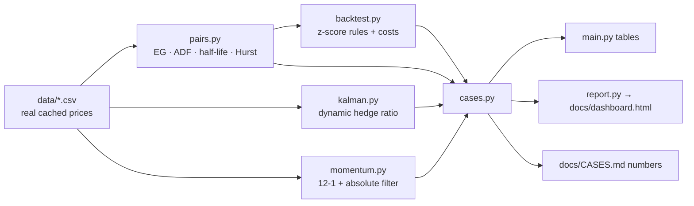

# StatArb Lab


**Statistical arbitrage, tested the way it actually fails.** Pairs trading
and dual momentum on *real* market data, with cointegration tests run in
both directions, a Kalman-filter hedge ratio, and case studies that report
the decay, the drawdowns and the losses — not just the equity curve.

> **The headline finding:** the market's most famous pair, Coke/Pepsi,
> *passes* the full-sample Engle-Granger cointegration test (p ≈ 0.028,
> half-life 34 days) — and the relationship is still an artefact. Neither
> half of the sample is cointegrated, the hedge ratio flips sign between
> halves (+2.02 → −0.31), and the Kalman hedge ratio never goes near the
> static OLS value. This repo exists to catch exactly that.

## Headline results (computed by the code, on the cached real data)

| Case | Result |
|---|---|
| **A — PEP/KO pair** | Full-sample cointegration p ≈ 0.028, backtest **+3.35 %**, Sharpe 0.56 — but split-sample test fails in *both* halves: cointegration decay, documented |
| **A — XOM/CVX pair** | Not cointegrated either direction; backtest **−3.56 %**, Sharpe −0.47, **18 of 39 trades stopped out** as the spread blew out (|z| = 5.18, Mar 2022) |
| **B — COVID crash 2020** | Dual-momentum max drawdown **−25.2 %** vs SPY **−33.7 %**; 31 Jan → 30 Apr 2020: **−2.5 % vs −9.2 %** |
| **C — Full period 2019 → 2026** | Dual momentum **+144.6 %**, Sharpe 0.75 vs SPY buy-and-hold **+219.1 %**, Sharpe 0.88 — the benchmark wins the bull market, and the report says so |

Full analysis with tables and reasoning: [docs/CASES.md](docs/CASES.md) ·
Visual summary: [docs/dashboard.html](docs/dashboard.html)

## Quickstart

```bash
pip install -r requirements.txt   # numpy, pandas, scipy only
python main.py                    # all three case studies, from cached data
python main.py --dashboard        # rebuild docs/dashboard.html
python -m pytest tests            # 21 tests
```

No network, no API keys: the price data ships in `data/` (see provenance
below). `examples/download_data.py` re-fetches it with yfinance if you want
a fresher cache; `examples/run_pair.py` shows library-style use.

## What's inside

| Module | Contents |
|---|---|
| `src/statarb/pairs.py` | OLS hedge ratio, **ADF test from scratch** (AIC lag selection, MacKinnon critical values), **Engle-Granger cointegration**, OU **half-life**, variance-ratio **Hurst exponent**, rolling z-score |
| `src/statarb/kalman.py` | **Kalman-filter dynamic hedge ratio** from scratch (state-space on the spread regression) |
| `src/statarb/backtest.py` | Day-by-day pairs backtest: z-score entry/exit/stop, costs on both legs, daily mark-to-market, exact accounting identity (unit-tested) |
| `src/statarb/momentum.py` | Cross-sectional 12-1 momentum + Antonacci-style **dual (absolute) momentum** filter, monthly rebalancing, turnover costs, daily equity curve |
| `src/statarb/cases.py` | The three case studies, computed end-to-end |
| `src/statarb/report.py` | Self-contained dark HTML dashboard generator (inline SVG, zero external references) |

## The maths, briefly

**Engle-Granger.** Step 1: regress `y = α + βx + s`. Step 2: test the
residuals `s` for a unit root. If `s` is stationary, the two I(1) series
are cointegrated and `s` is a tradable spread. The residual test must use
Engle-Granger critical values (−3.90 / −3.34 / −3.04 at 1/5/10 %), *not*
plain ADF values, because β was estimated — using the wrong table is the
most common silent error in pairs-trading code on GitHub. The test is also
**not symmetric**: PEP~KO and KO~PEP give different answers (−3.55 vs
−1.40 here), so this repo always runs both directions.

**Half-life.** For an Ornstein-Uhlenbeck spread
`ds = θ(μ − s)dt + σ dW`, regressing `Δs_t = λ s_{t−1} + c` gives
**half-life = −ln 2 / λ**: the expected time for a deviation to halve.
PEP/KO's 34 days looks tradable — until the split sample shows λ itself
is not stable.

**Hurst exponent** by variance ratios: Var(x_{t+q} − x_t) ~ q^{2H};
H < 0.5 marks mean reversion (PEP/KO spread: 0.42), H ≈ 0.5 a random
walk, H > 0.5 a trending series.

**Kalman hedge ratio.** Observation `y_t = [1, x_t]·θ_t + e_t`, state
`θ_t = θ_{t−1} + w_t` with θ = (α, β). The filtered β_t path is the
diagnostic that convicts Case A: it ranges 0.55–3.04 and ends at 1.47,
while the static OLS β is −0.39. A hedge ratio that will not sit still is
not a hedge ratio.

**Dual momentum.** Rank risk assets by 12-1 return
`P_{t−1}/P_{t−12} − 1` (Jegadeesh–Titman, skipping the reversal-prone
last month); hold the top 3 whose momentum is also positive in absolute
terms (Antonacci); park the rest in long Treasuries. Monthly signals
cushion crashes — Case B — but react weeks late, and in a long bull
market the insurance premium exceeds the payout (Case C).

## Architecture



## Data provenance

| File | Tickers | Period | Source |
|---|---|---|---|
| `data/pairs_prices.csv` | KO, PEP, XOM, CVX | 2021-11-04 → 2026-11-04 (1,255 rows) | Yahoo Finance via yfinance, adjusted closes |
| `data/momentum_prices.csv` | SPY, QQQ, EFA, EEM, TLT, GLD, VNQ | 2018-01-02 → 2026-11-04 (2,223 rows) | Yahoo Finance via yfinance, adjusted closes |

Downloaded **2026-11-04** with `examples/download_data.py`. Two deliberate
choices: the momentum file starts in 2018 because a 5-year window would
exclude the Feb–Apr 2020 COVID crash (Case B); and tickers are fetched
individually because yfinance's bulk endpoint silently returned no TLT
data on the download date.

## Honest limitations

Survivorship in the ticker selection; full-sample hedge ratios in the
Case A backtest (the case is *about* their instability); p-values
interpolated from MacKinnon response surfaces (critical-value decisions
exact, decimal p-values approximate); flat-bps costs with no slippage or
borrow; the absolute-momentum hurdle is cash ≈ 0 because no T-bill series
is bundled. Each is expanded in [docs/CASES.md](docs/CASES.md#limitations).

## References

Engle & Granger (1987) · MacKinnon (1991, 1994) · Jegadeesh & Titman
(1993) · Antonacci, *Dual Momentum Investing* (2014) · Chan,
*Algorithmic Trading* (2013) · Daniel & Moskowitz (2016) on momentum
crashes · Vidyamurthy, *Pairs Trading* (2004).

*Research and education only — not financial advice. Every strategy in
this repo is shown with its failure modes attached; past performance
does not predict future results, and cointegration in particular has a
habit of expiring exactly when it is most leveraged.*
